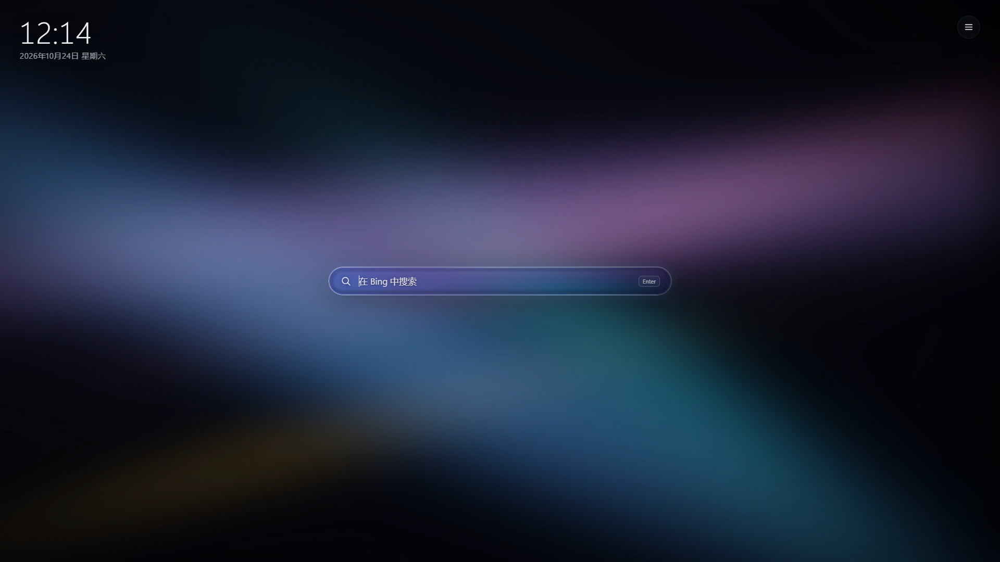
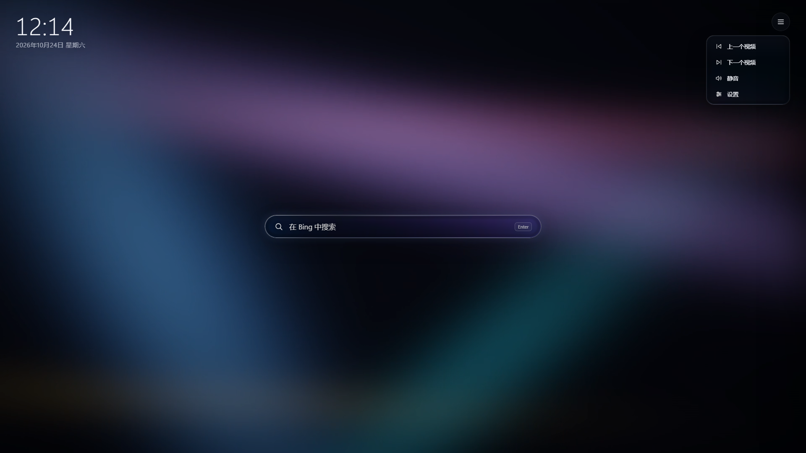
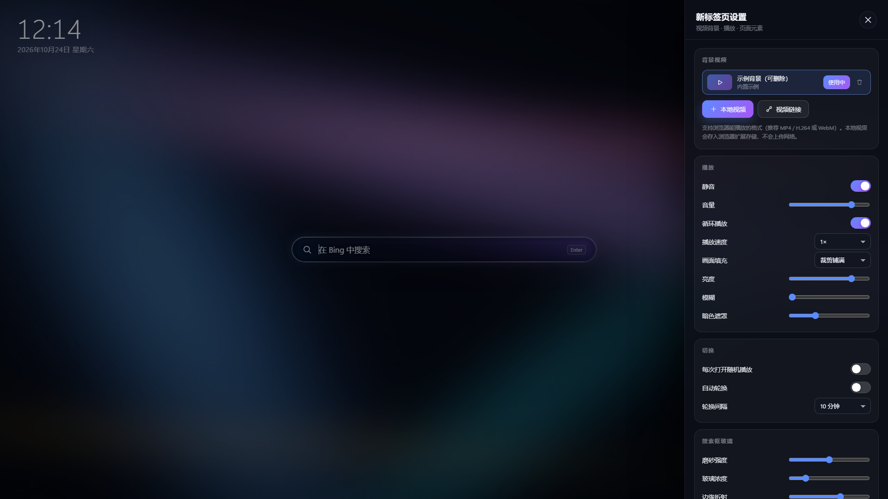
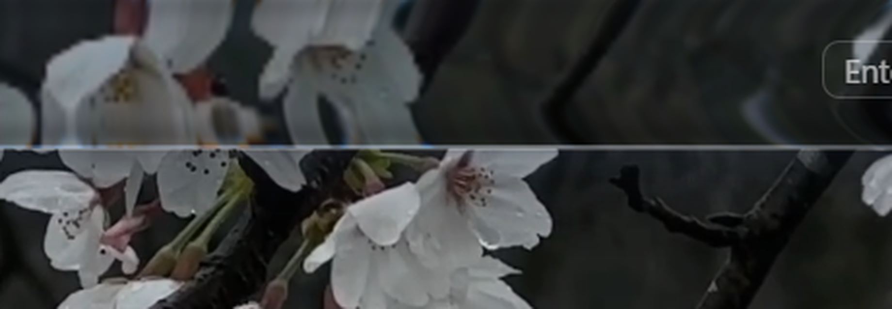

# 视频新标签页 · Video New Tab

> 把 Edge 新标签页变成可自由更换视频的沉浸式背景，搭配 WebGL 实时渲染的「液态玻璃」搜索框。



一个 Microsoft Edge 新标签页扩展：用循环播放的视频替代默认新标签页背景，并内置一块实时渲染的液态玻璃搜索框。支持本地视频、视频直链、播放列表、时钟日期和玻璃参数调节，所有数据只保存在本机。

---

## ✨ 功能

- **视频背景**：内置示例视频；可添加本地视频文件（直接拖进页面）或视频直链
- **播放列表**：上一个 / 下一个、随机播放、1～60 分钟自动轮换
- **WebGL 液态玻璃搜索框**：实时磨砂、边缘透镜折射、色散、按法线方向的高光；5 个滑杆可调（磨砂强度、玻璃浓度、边缘折射、镜片厚度、色散）
- **玻璃快捷菜单**：右上角单个「≡」按钮，内含上一个视频 / 下一个视频 / 静音 / 设置，和搜索框使用同一套玻璃材质
- **页面元素**：时钟、日期、搜索框均可显示 / 隐藏；搜索框位置可选「左上角 / 居中」（默认左上角）；支持 Bing、百度、Google
- **播放控制**：音量、播放速度、画面填充方式可调
- **完全本地**：视频与设置只保存在本机，扩展不收集、不上传任何数据

## 📸 截图

| 主界面 | 快捷菜单 |
| --- | --- |
|  |  |

| 玻璃设置 | 边缘折射特写 |
| --- | --- |
|  |  |

更多：商店截图（[主界面](store/screenshots/01-main.png) · [快捷菜单](store/screenshots/02-menu.png) · [玻璃设置](store/screenshots/03-settings.png)）、[实时玻璃渲染演示](preview/liquid-glass-demo.png)。

## 🚀 安装

### 方式一：开发者模式（从源码加载）

1. 克隆或下载本仓库
2. 打开 Edge，地址栏输入 `edge://extensions/`
3. 打开右下角「开发人员模式」
4. 点击「加载解压缩的扩展」，选择本仓库的 `extension/` 文件夹
5. 按 `Ctrl+T` 打开新标签页即可看到效果

### 方式二：Microsoft Edge 加载项商店

已在 **Microsoft Edge 加载项商店** 上架：

- 名称：视频新标签页
- 版本：1.3.0
- Store ID：`0RDCKBMWDVNB`
- CRX ID：`ddccmlebbnfkjbfkkkpcdfpgonmidgni`

商店链接：https://microsoftedge.microsoft.com/addons/detail/ddccmlebbnfkjbfkkkpcdfpgonmidgni

> 注意：商店版本与开发者模式版本使用不同的扩展 ID，本地数据（视频、设置）不互通。

## 🗂 目录结构

```
extension/      扩展源码（Manifest V3）
docs/           使用说明 / 验证记录 / 性能测试记录
store/          商店上架材料（中英文案、隐私政策、截图、宣传图、提交指南、发行包）
preview/        预览截图
```

## 🔧 技术实现

- **Manifest V3** + `chrome_url_overrides.newtab`，仅申请 `storage` / `unlimitedStorage`
- **视频背景**：`<video>` + CSS 滤镜/缩放；本地视频以 Blob 存入 IndexedDB，播放列表与设置存 `chrome.storage.local`
- **液态玻璃（WebGL）**：片元着色器实时计算
  - 圆角矩形 SDF、边缘倒角透镜折射（向内采样位移）、轻微色散
  - 随位置变化的磨砂、按法线方向的高光与内倒角阴影
  - 搜索框与快捷菜单共享同一帧视频纹理；仅渲染玻璃区域、30fps 上限
  - 标签页隐藏或视频暂停时停止渲染；WebGL 不可用时自动回退 CSS 毛玻璃
- **无外部依赖、无远程代码**，所有 JS/CSS/资源打包在扩展内

## 📊 性能

在 AMD Radeon 780M 核显上解除帧率上限实测（4 秒平均帧率）：

| 场景 | WebGL 实时玻璃 | 旧版 CSS 滤镜方案 |
| --- | --- | --- |
| 默认设置 | 328.9 fps | 276.9 fps |
| 最重设置 | 154.2 fps | 58.5 fps |

实际渲染锁定 30fps，只渲染搜索框大小区域，日常开销很小。详见 [docs/performance-test.md](docs/performance-test.md)。

## 🔒 隐私

- 不收集、不上传、不分享任何个人数据；无分析、广告、追踪或第三方 SDK
- 设置保存在 `chrome.storage.local`，视频文件保存在本机 IndexedDB
- 仅当用户主动添加视频直链时，浏览器才会请求该地址
- 卸载扩展即删除本地数据

详见 [store/privacy-policy.md](store/privacy-policy.md)。

## 🛒 商店上架材料

`store/` 目录包含完整的 Microsoft Edge Add-ons 上架材料，可直接参考：

- [中文商店文案](store/listing-zh.md) / [English listing](store/listing-en.md)
- [隐私政策](store/privacy-policy.md)
- [提交指南](store/submission-guide.md) / [审核测试说明](store/review-notes.md)
- [提交记录](store/submission-record.md)
- 发行包：[video-new-tab-v1.2.0.zip](store/package/video-new-tab-v1.3.0.zip)
- 截图、宣传图、商店 Logo

## 📄 更多文档

- [使用说明](docs/usage-zh.md)
- [验证记录](docs/verification-log.md)
- [性能测试记录](docs/performance-test.md)

## ⚠️ 说明

- 本项目为个人作品，代码仅供学习参考，未附带开源许可证（保留所有权利）。
- 内置示例视频 `extension/media/demo.mp4` 为项目作者生成，可自由用于演示。
- 若发现 bug 或有功能建议，欢迎提交 Issue。

---

作者：**ChugeTan**
